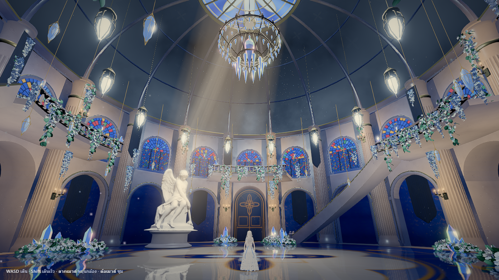

# Hi, I'm Wutthichai

I build complete systems from scratch: shipped mobile software, browser games, real-time WebGL experiences, and the measurement tools that tell me when they fail.

First-year Computer Science student.

---

## Flagship work

**[The Crystal Ballroom](projects/crystal-ballroom/README.md)** · [explore the live 3D scene](https://crystal-ballroom-lunaria.web.app/)

A walkable fantasy hall built with a scripted Blender-to-Three.js pipeline. The scene combines stained glass, a reflective floor, lighting effects, collision, and Lunaria, a rigged and animated character. [Build notes and credits](projects/crystal-ballroom/README.md).

`Blender · Three.js · WebGL · 3D character animation`

**[MERIDIAN ONE](https://github.com/sacmaib80-cmyk/meridian-pen)** · [live](https://sacmaib80-cmyk.github.io/meridian-pen/)

A scroll-driven product site whose pen, internals, lighting, ink trace, and post-processing are generated live in raw WebGL2. No image or 3D-model assets.

`WebGL2 · procedural geometry · IBL · adaptive resolution`

**[DEEPWARD](https://github.com/sacmaib80-cmyk/deepward)** · [live](https://sacmaib80-cmyk.github.io/deepward/)

A bilingual vertical-city game-site concept where one depth value drives chronology, light, palette, copy, interface readouts, and scene transitions.

`Vanilla JS · WebGL2 · i18n · 61 browser checks`

**[SakuraQ](https://github.com/sacmaib80-cmyk/sakuraq)** · [web app](https://sakuraq-b7f96.web.app/welcome.html)

A quest-style focus system shipped as an Android APK and installable PWA. Recent iterations added calendar-based plans, user-defined goal tags, cloud sync, OS-level alarms, and full-scene cosmetics.

`Vanilla JS · Capacitor · Firebase · PWA`

**[WebStudy](https://github.com/sacmaib80-cmyk/webstudy)** · [live lab](https://sacmaib80-cmyk.github.io/webstudy/)

Five accepted real-time graphics experiments kept beside executable checks for shaders, simulations, interaction, layout, and frame cost.

`WebGL2 · GPU simulation · browser QA`

---

## Systems and games

**[AI Flow](https://github.com/sacmaib80-cmyk/ai-flow)**

A live, evidence-first map of local automations, logs, scheduler state, failures, and verified data paths.

`Node.js · WebSocket · SQLite`

**[Pixel Clash](https://github.com/sacmaib80-cmyk/pixel-clash)**

A peer-to-peer pixel fighter with four-character rooms, fixed-step simulation, code-drawn art, combos, and finishers.

`React · Canvas 2D · WebRTC · Capacitor`

**[Moonfall](https://github.com/sacmaib80-cmyk/moonfall)**

A social-deduction game whose bots observe, build suspicion, avoid witnesses, pathfind, lie, and vote.

`Vanilla JS · Canvas 2D · A* · headless balance simulation`

**[SakuraQ Native](https://github.com/sacmaib80-cmyk/sakuraq-native)**

A deliberate native rewrite of SakuraQ with timestamp-safe timers and 22 tests around scoring and abuse cases.

`Kotlin · Jetpack Compose · DataStore`

**[Code Dojo](https://github.com/sacmaib80-cmyk/code-dojo)** · [live](https://sakuraq-b7f96.web.app/dojo/)

A teaching site with 217 exercises across 21 progressively unlocked stages. The live version now also has shared code and flowchart rooms, multi-user cursors, TypeScript diagnostics, and saved code runs; the repository holds the standalone exercise app.

`HTML · CSS · JavaScript · TypeScript tooling · realtime collaboration`

---

## Reusable engineering

**[webgl-kit](https://github.com/sacmaib80-cmyk/webgl-kit)**

Dependency-free WebGL2 modules for shaders, IBL, fluids, heightfields, ribbons, and adaptive quality, with real browser compilation checks.

**[web-kit](https://github.com/sacmaib80-cmyk/web-kit)**
Small scroll, motion, localisation, asset, video, and browser-audit utilities extracted from visual-site production work.

---

## How I work

I prefer evidence over presentation claims: runnable checks, real-device constraints, measured frame cost, release artefacts, and notes about what is still incomplete.
