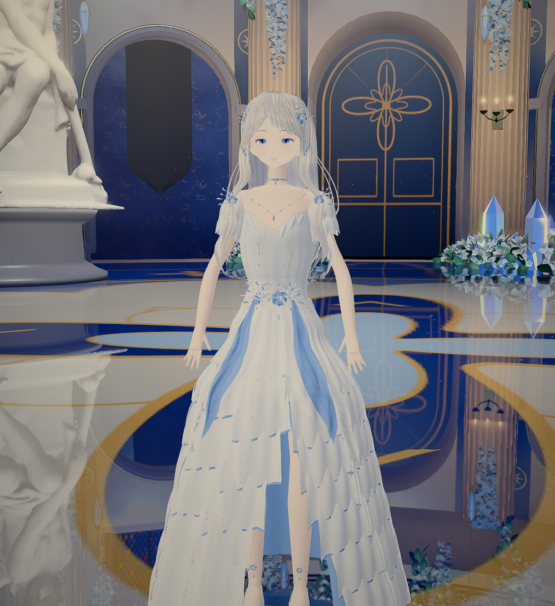

# The Crystal Ballroom

[Explore the live scene](https://crystal-ballroom-lunaria.web.app/) · [Back to the portfolio](../../README.md)

A walkable fantasy ballroom built from a scripted Blender scene and rendered in the browser with Three.js. Lunaria, a rigged and animated character, can move through the hall.

## What I built

- **Scripted environment:** Blender scripts construct the shell, dome, balcony, stairs, columns, floral fixtures, and lighting. The scene exports to glTF for the browser.
- **Realtime presentation:** The Three.js viewer adds stained glass, a reflective floor, bloom, camera controls, movement, and collision checks. The scene merges repeated geometry by material to reduce draw calls.
- **Character integration:** Lunaria has a custom body, clothing, hair, rig, facial morphs, and animation clips. Her browser controller handles movement, blinking, and hair motion.
- **Verification:** Browser checks cover loading errors, collision, and stair traversal; the public build was also checked after deployment. The live URL returned HTTP 200 on 19 September 2026.

## Controls

`WASD` move · `Shift` move faster · drag to rotate the camera · scroll to zoom. A desktop browser with WebGL support is recommended; the initial download is large.

## Credits and limits

The angel statue is [Engel by noe-3d.at](https://sketchfab.com/3d-models/engel-0d54d997ca3e4e2cb46141708bb82015), provided under CC0 1.0. Lunaria's head began from [pixiv's VRM1 Constraint Twist Sample](https://github.com/pixiv/three-vrm/blob/dev/packages/three-vrm/examples/models/VRM1_Constraint_Twist_Sample.vrm) and retains the terms of its [VRM Public License 1.0](https://vrm.dev/licenses/1.0/); the character's body, outfit, hair, rig, and scene integration were made for this project.

The scene has been tested on the development machine's 2 GB graphics card, but performance varies by browser and device. This portfolio entry documents the shipped experience and selected implementation details; the large working Blender files are outside this profile repository.
